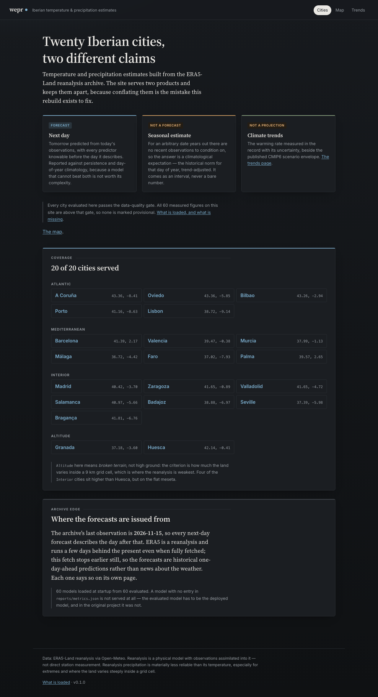
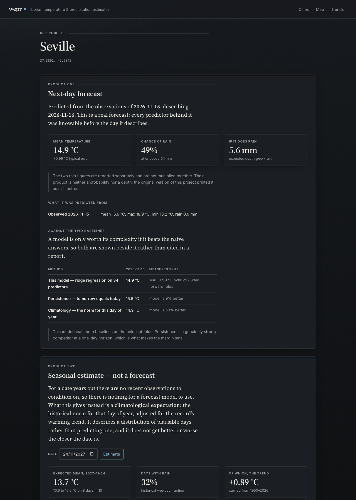
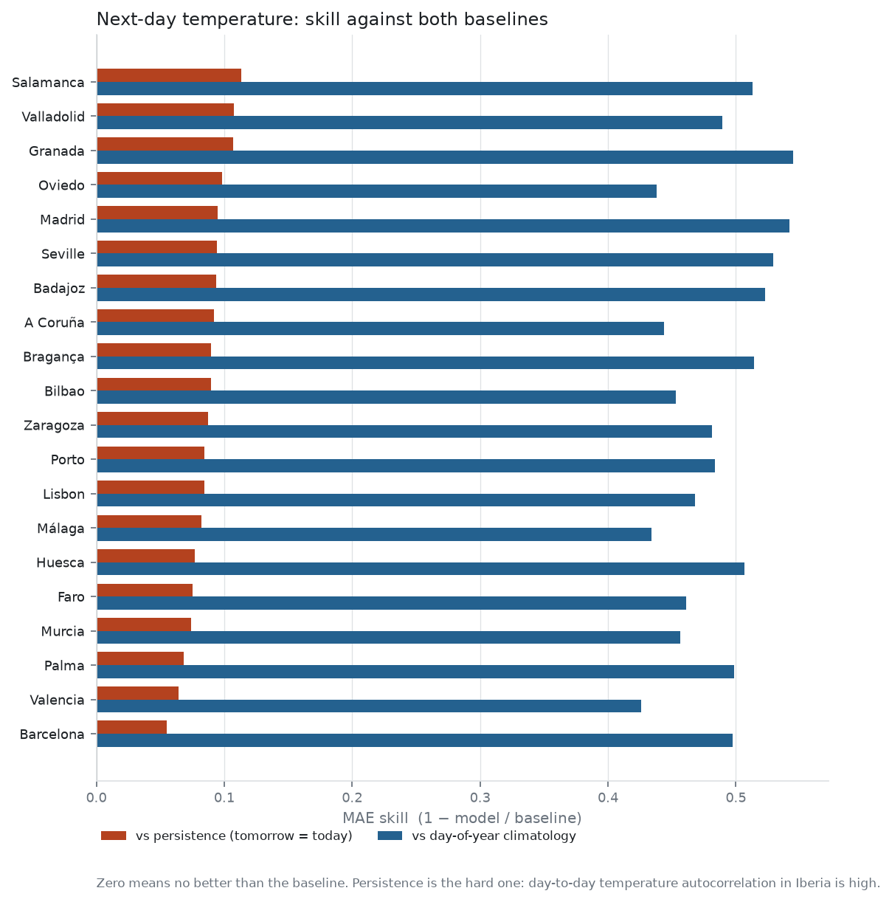
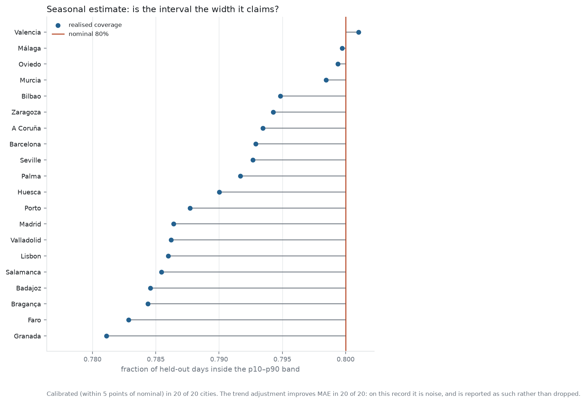
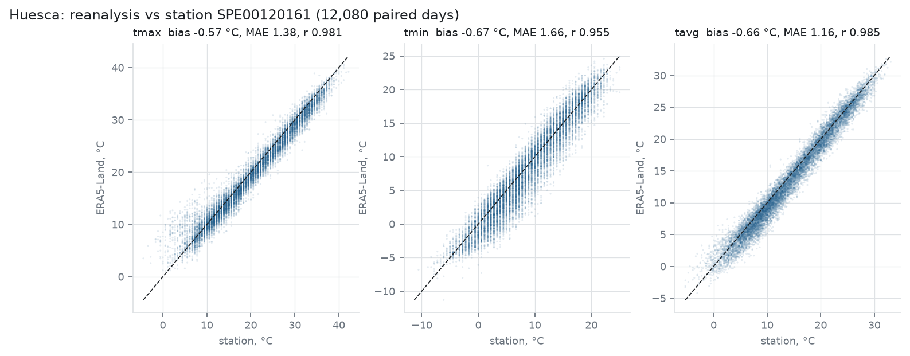
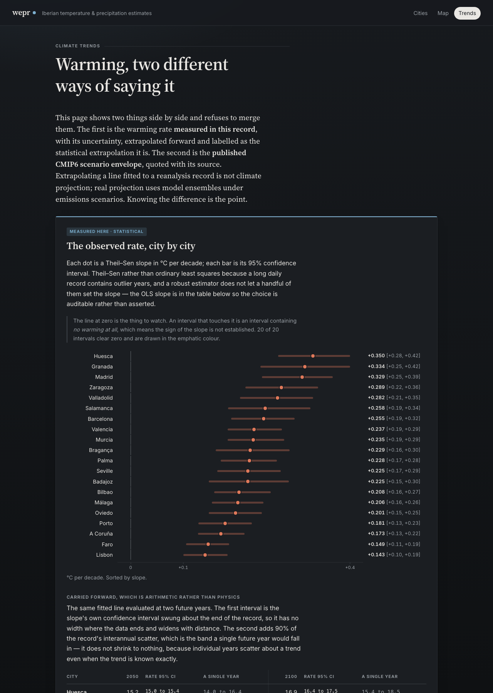
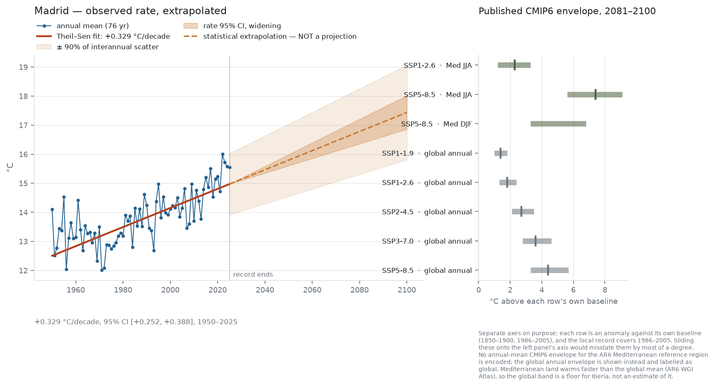
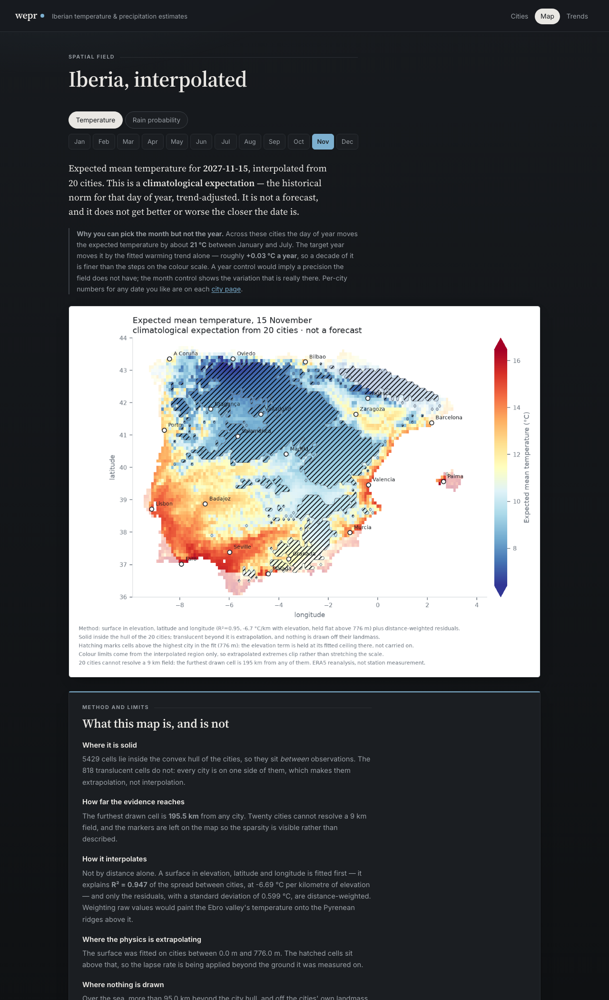
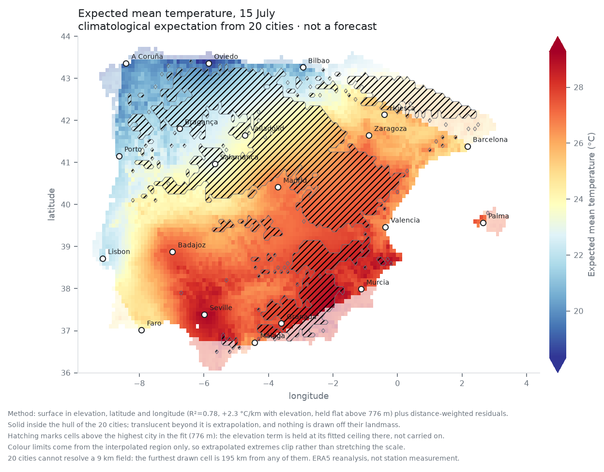
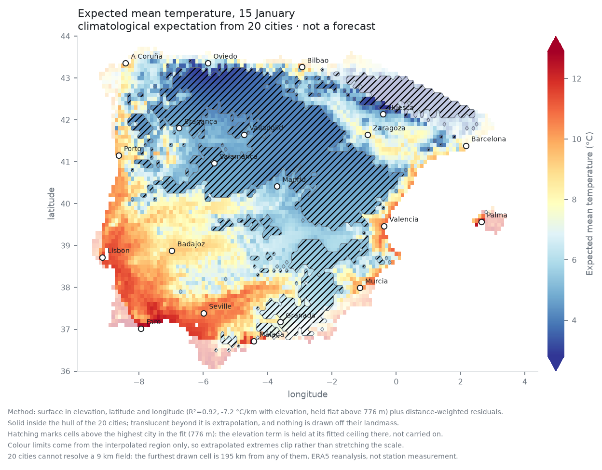

# wepr

**Temperature and precipitation estimates for twenty cities across Spain and Portugal,
served by a Flask app from models trained on 76 years of ECMWF reanalysis.**


| | |
|---|---|
| **Record** | 1950-01-01 → 2026-11-15 · 28,078 days · 76.9 years · 20 cities · **0.00% missing** |
| **Source** | ERA5-Land (temperature, 0.1°) + ERA5 (precipitation, 0.25°), via the Open-Meteo archive |
| **Models** | 60 — next-day temperature, next-day rain, seasonal expectation, one set per city |
| **Headline** | next-day temperature **MAE 0.77–1.35 °C**, beating persistence by 5.5–11.3% on 20/20 cities |
| **Validated** | against independent NOAA GHCN station records: **r = 0.98, MAE 1.38 °C** on 12,080 paired days |

This began as a UK Extended Project Qualification artefact covering two cities and a
handful of station CSVs. It has been rebuilt as a portfolio project: twenty cities, a
reanalysis archive in place of the CSVs, the two products separated, every figure
measured against baselines, and the original station data repurposed as an independent
validation set.

---

## The app



The index states the two products as two different claims before it lists a single
number, and the coverage panel says how many of the twenty cities are actually being
served rather than implying all of them always are.



A city page shows both products and refuses to blur them. The next-day panel is dated
at both ends — predicted *from* 2026-11-15, describing 2026-11-16 — carries the
observations it was predicted from, and puts the model in a table **beside both
baselines** with the measured skill against each. The two rain figures sit next to a
note saying they are not multiplied together, because the original version of this
project multiplied them and printed the result as millimetres.

The seasonal panel is a separate block in a different colour, headed "not a forecast",
and reports its interval and the size of the trend term it carried.

<sub>Screenshots are the site's dark theme. Light is the primary design and the dark
steps are a second set from the same hues, not an inversion; the page follows
`prefers-color-scheme`.</sub>

---

## What it does

Two deliberately separate products, because conflating them is the easiest way to be
wrong in public.

**Next-day forecast.** Predicts tomorrow from observations available today. A genuine
forecast, evaluated by walk-forward backtesting against two baselines — day-of-year
climatology and persistence ("tomorrow = today"). Persistence is hard to beat at
one-day range, and the margin over it is the figure that matters; it is reported below
and it is single-digit.

**Seasonal estimate.** For a date years out there are no recent observations to
condition on, so there is nothing for a forecast model to use. The honest output is the
climatological expectation for that day of year, trend-adjusted, with an interval. It is
labelled as such and never presented as a forecast.

**Climate trends.** A third page shows the warming rate measured in the record with its
confidence interval, extrapolated forward with bands that widen, beside the published
IPCC AR6 / CMIP6 scenario envelope with its citation — because a trend extrapolation is
not a climate projection, and showing the difference is the point.

---

## Measured accuracy

Every figure here is read from `reports/metrics.json`, written by
`scripts/evaluate_all.py` and keyed to the model files the app actually serves. The
evaluation is walk-forward: expanding-window folds starting at 3,650 days and stepping
90 days, so each prediction is made from a model fitted only on dates before it. That
gives **252 folds** per next-day model and **66** per seasonal model.

| Product | Metric | Range over 20 cities | Beats both baselines |
|---|---|---|---|
| Next-day temperature | MAE | **0.77 – 1.35 °C** (median 1.04) | 20 / 20 |
| Next-day temperature | skill vs. day-of-year climatology | +42.6% – +54.5% (median +48.6%) | |
| Next-day temperature | skill vs. persistence | **+5.5% – +11.3%** (median +8.9%) | |
| Next-day rain | Brier score | 0.135 – 0.217 (median 0.187) | 20 / 20 |
| Next-day rain | Brier skill vs. climatology | +9.3% – +29.1% (median +15.6%) | |
| Seasonal temperature | MAE | 1.41 – 2.57 °C (median 1.94) | |
| Seasonal temperature | 80% interval coverage | 78.1% – 80.1% (nominal 80%) | 20 / 20 calibrated |



Three things in that table are worth reading carefully rather than skimming.

**The honest headline is the persistence column, not the climatology column.** Beating a
day-of-year climatology by half is easy — it has no idea what today looked like. Beating
"tomorrow = today" by 5–11% is the actual claim, and at one-day range that is a
reasonable result rather than an impressive one. The next-day model is a
`StandardScaler → RidgeCV` pipeline over **34 causal predictors**; it beats climatology
in all 252 folds of all twenty cities, and persistence in **227–245** of those 252 — so
the margin is consistent across folds, not an average rescued by a good run.

**Rain is reported as a probability, never as millimetres.** Precipitation is
zero-inflated and comes from the coarser ERA5 grid, so the headline is an occurrence
probability with a Brier score attached. A two-stage model (occurrence classifier ×
conditional amount) is the right shape for the target, but the product of a probability
and a conditional amount is not a millimetre figure and is not presented as one.

**The seasonal product is barely better than its own climatology, and that is the
finding.** Skill over a day-of-year climatology with the trend term zeroed is
**+0.5% – +4.2%** — positive on all twenty cities, consistently, and small. What it buys
is the trend term, sound on all twenty on this record. The more useful number is the
interval calibration: 80% intervals covering 78.1–80.1% of outcomes means the stated
uncertainty is close to real.



---

## Is the data any good?

The app is built on **reanalysis**, not observation — a physical model with observations
assimilated into it. That is defensible here (complete, gap-free, spatially uniform,
76 years long) but it is not measurement, and saying so is not enough on its own.

So the two original NOAA GHCN-Daily station exports are kept in `data/validation/` and
the reanalysis is checked against them. *"I validated the reanalysis against independent
station records"* is a materially stronger claim than either source alone.



**Huesca, station `SPE00120161`, 12,080 paired days:**

| Variable | Bias (ERA5 − station) | MAE | RMSE | r |
|---|---:|---:|---:|---:|
| `tmax` | −0.57 °C | 1.38 | 1.85 | **0.981** |
| `tmin` | −0.67 °C | 1.66 | 2.13 | 0.955 |
| `tavg` | −0.66 °C | 1.16 | 1.48 | **0.985** |
| `prcp` | +1.04 mm | 1.86 | 5.01 | 0.580 |

Valencia (`SPM00008284`) agrees even more closely on `tavg` — bias −0.09 °C, MAE
0.64 °C, **r = 0.991** over 12,473 days — but 43% of its TMIN and 35% of its TMAX days
are missing, so it supports a temperature comparison only.

Two traps in that comparison, both of which otherwise read as reanalysis error:

- **Definition.** ERA5's `temperature_2m_mean` is a true 24-hour average, while Huesca's
  export has no TAVG and its mean is the midrange `(TMAX + TMIN) / 2`, which runs
  systematically warm — a diurnal curve spends more of the day near its minimum. So
  `tmax`/`tmin` are the like-for-like comparisons and `tavg` carries that caveat.
- **Location.** Huesca's export states `LONGITUDE 0.3264`, east of Greenwich, which
  would put the station 60 km from the city. The sign is lost in the export: at
  0.3264 **W** the archive's grid elevation is 544 m against the station's stated 541 m,
  where the eastern reading lands on a 791 m cell.
  `wepr.data.validate.station_location_check` resolves this empirically rather than
  asserting it.

**And the precipitation row is the important one.** `r = 0.58` on daily rainfall, a
+1.04 mm/day wet bias, and scoring *occurrence* over a 1 mm threshold gives a hit rate
of 0.833 against a false-alarm ratio of 0.508 and a frequency bias of **1.69** — ERA5
records 3,452 wet days where the gauge records 2,039. Reanalysis drizzles. That is
measured, not assumed, and it is exactly why the app reports rain **probability** rather
than a millimetre figure to two decimal places.

---

## Climate trends



The page's chart is a forest plot of the twenty slopes against a zero line, and the
line at zero is the thing to watch: an interval touching it is an interval containing
*no warming at all*. On this 76-year record **20 of 20 clear zero**, and the template
says which case it is rather than hard-coding either — on an earlier 22-year fetch
*none* did, and the flat field of one colour was the finding rather than a rendering
choice.



Theil–Sen rather than OLS, because a long daily record contains outlier years; the OLS
slope is reported beside it so the choice of estimator is auditable rather than
asserted. Across the twenty cities the measured rate runs **+0.143 °C/decade (Lisbon) to
+0.350 (Huesca)**, and **all twenty confidence intervals exclude zero**.

The two claims on this page are kept apart *structurally*, not just in wording:
`cities[].extrapolation` and `scenarios` are separate keys that are never merged into
one series, and the page draws them as two panels sharing no axis. That is not a
stylistic choice. `summary()["baselines"]` records which scenario baseline periods the
local record actually covers, and the answer is one of the two: **all twenty cities
cover 1986–2005, none covers 1850–1900** — and 1850–1900 is the baseline AR6's headline
ranges are quoted against. Sliding an 1850–1900 anomaly onto a 1950-baselined axis would
overstate it by most of a degree, which is the size of the effect under discussion. No
refetch can fix that: ERA5 itself begins in 1950, so the pre-industrial baseline is
outside the archive, not outside the download.

**One result is worth stating plainly, because it is the kind of thing a short record
hides.** An earlier fetch covered 1978–2025 and produced rates of +0.22 to +0.56
°C/decade. Restoring 1950–1977 — the mid-century plateau — cut the *same estimator's*
rates to +0.14 to +0.35. The warming is unambiguous either way; the **rate was
overstated by roughly two thirds** by a window that happened to start at the bottom of a
trough. Nothing about the model changed between those two answers, only the span of
record handed to it.

<details>
<summary><b>All twenty cities</b> — Theil–Sen °C/decade with 95% CI</summary>

| City | Region | °C/decade | 95% CI | OLS |
|---|---|---:|---|---:|
| Huesca | Altitude | +0.350 | [+0.283, +0.421] | +0.336 |
| Granada | Altitude | +0.334 | [+0.249, +0.421] | +0.325 |
| Madrid | Interior | +0.329 | [+0.252, +0.388] | +0.304 |
| Zaragoza | Interior | +0.289 | [+0.220, +0.360] | +0.281 |
| Valladolid | Interior | +0.282 | [+0.210, +0.350] | +0.272 |
| Salamanca | Interior | +0.258 | [+0.187, +0.345] | +0.255 |
| Barcelona | Mediterranean | +0.255 | [+0.193, +0.315] | +0.248 |
| Valencia | Mediterranean | +0.237 | [+0.186, +0.290] | +0.229 |
| Murcia | Mediterranean | +0.235 | [+0.186, +0.295] | +0.242 |
| Bragança | Interior | +0.229 | [+0.163, +0.305] | +0.232 |
| Palma | Mediterranean | +0.228 | [+0.173, +0.281] | +0.221 |
| Seville | Interior | +0.225 | [+0.166, +0.288] | +0.221 |
| Badajoz | Interior | +0.225 | [+0.150, +0.304] | +0.235 |
| Bilbao | Atlantic | +0.208 | [+0.160, +0.269] | +0.209 |
| Málaga | Mediterranean | +0.206 | [+0.156, +0.255] | +0.204 |
| Oviedo | Atlantic | +0.201 | [+0.150, +0.252] | +0.199 |
| Porto | Atlantic | +0.181 | [+0.130, +0.233] | +0.174 |
| A Coruña | Atlantic | +0.173 | [+0.129, +0.219] | +0.164 |
| Faro | Mediterranean | +0.149 | [+0.106, +0.189] | +0.144 |
| Lisbon | Atlantic | +0.143 | [+0.101, +0.186] | +0.140 |

All spans 1950–2025, 76 years. The full table with its scenario sources is written to
`reports/trends.md` by `scripts/make_figures.py`, and served as JSON at `/api/trends`.

</details>

---

## The map

Twenty cities interpolated into a continuous field over Iberia — a picture that implies
far more spatial resolution than twenty points support, so the map is built to show its
own limits rather than describe them in a caption.



The field is published for all twelve months and the page opens on the **current** one,
chosen at request time from what is on disk, so it follows the calendar instead of
going stale between regenerations. There is deliberately **no year control**: across
these cities the day of year moves expected temperature by about 21 °C between January
and July, while the target year moves it by the fitted trend alone — roughly
+0.03 °C/year, finer than a step on the colour scale. A year field would imply a
precision the field does not have.

It does not weight raw values by distance. A linear surface in **elevation, latitude and
longitude** is fitted first — across these cities that predicts annual mean temperature
to a leave-one-out MAE of **0.45 °C**, against 1.95 °C for the city mean alone, at a
physically sensible lapse rate of about **−4.4 °C/km** — and only the residuals are
distance-weighted. Interpolating raw values would paint the Ebro valley's temperature
onto the 2,500 m Pyrenean cells above it. The design was chosen by cross-validation over
the twenty cities, not by in-sample fit.

What the map shows about itself:

- **solid** inside the convex hull of the cities, where a cell sits between
  observations; **translucent** outside it, where every city is on one side and the
  value is an extrapolation;
- **hatched** above the highest city the surface was fitted on (776 m) — the Pyrenees
  and the Sierra Nevada — where the elevation term is *held at its fitted ceiling*
  rather than carried further;
- **city markers on top**, always, so the sparsity of the evidence stays visible;
- **nothing at all** over the sea, beyond 95 km from the city hull, or off the cities'
  own landmass.

### The bug the figure caught, and no test could

The elevation clamp is not defensive boilerplate. The cities span 0–776 m; the grid
reaches 3,064 m, so that term is the one covariate asked to reach kilometres beyond its
data.



Across these twenty cities, **July temperature has zero correlation with elevation**
(+0.00) — Iberian summer heat is continental — yet the fit still assigns **+2.3 °C/km**,
because once latitude and longitude absorb the north–south gradient, the leftover
elevation spread tracks continentality instead (Atlantic cities at sea level and
20.2 °C, Interior at 475 m and 25.4 °C). Unclamped, that coefficient reached 3,064 m,
added **+5.3 °C**, and made the Sierra Nevada and the Pyrenees the hottest ground in
Iberia on a July map — the exact failure the residual design exists to prevent, with the
sign reversed.

The annual fit is fine (−3.81 °C/km) and January is correctly signed (−7.72), so only
the summer map exposes it:



The module had previously claimed elevation "contributes almost nothing in July, but it
costs nothing either". In-sample, true. Out-of-sample, on exactly the terrain being
drawn, it cost five degrees. **The figure was the test** — a covariate that is harmless
in-sample across twenty low-lying cities is not harmless when evaluated on terrain none
of them occupy. `tests/test_spatial.py` now keeps the guard executable — the surface
records the elevation range it was fitted on, `predict` holds the term flat above *and*
below that range, the field flags which cells were clamped, and one test reproduces the
July confound on the real city geometry.

### Excluding North Africa

By **land connectivity**, not by distance. On the 0.1° grid Tarifa is 90.9 km outside
the city hull and Tetouan is 89.0 km, so no distance threshold separates them — but the
Strait of Gibraltar is water, so a connected-component filter does.

The land mask and the elevation covariate are the same artifact,
`data/grid/elevation.npz`, fetched from the same digital elevation model the archive
reports for the cell it served (Madrid comes back as 666 m either way), so the map's
terrain and the data's terrain cannot disagree. It is committed, because terrain is
static reference data and a clone should render the map with no network call. Its one
known failure: the endpoint clamps at zero instead of returning bathymetry, so land at
or below sea level — the Guadalquivir marshes, the Albufera — reads as sea and goes
unpainted. The error direction is toward *not* painting, which is the right way round.

---

## How it serves

The Flask factory loads every trained model from `models/`, reads
`reports/metrics.json`, and builds each city's inference feature row **once, at
startup** — about a second for twenty cities and sixty models. A request is then a
dictionary lookup and a `predict` call. **A web request never triggers analysis**,
because analysis that happens per request is analysis nobody has evaluated.

`wepr.serve.ModelStore` is the only place a trained model and an HTTP request meet.
Three refusals are built into that load, and each returns `503` naming the command that
fixes it rather than a placeholder number:

| Refusal | What it catches |
|---|---|
| no entry in `reports/metrics.json` | an unevaluated model reaching a user. The key that names the file on disk also names the metrics entry |
| class ≠ the recorded `deployed_estimator` | someone swapping the estimator under the same filename — a key check alone would pass |
| `joblib` artifact from a different scikit-learn | a stale pickle deserialising into something subtly different |

The second is the one that would have caught the original project, where the published
MAE came from Ridge and RandomForest while the app served an unevaluated Prophet.

**None of these stop the app booting.** An empty `models/` is the normal state of a fresh
clone, so the app starts, says what is missing, and keeps serving the pages that do not
need a model.

### The forecast is dated, never called "tomorrow"

ERA5 is a reanalysis and runs about a week behind the present even when fully fetched,
so the next-day product is "one day ahead of the last observation in the record", not
"tomorrow". Every response carries `as_of`, `valid_for` and `lag_days`, and the UI shows
all three. It is a genuine one-day-ahead prediction from information strictly prior to
its date — exactly what the backtest measured — but it is not news about today's
weather, and the page says so in those words.

Both baselines travel with every prediction: what persistence and the day-of-year
climatology say for the same date are in the JSON and on the page, so a model number can
never be shown alone.

### Endpoints

```
Pages
  GET /                               the cities, and which are currently served
  GET /city/<slug>                    both products, labelled as different claims
  GET /map[/<variable>[/<month>]]     the interpolated field, and its own limits
  GET /trends                         the measured rate beside the published envelope

JSON
  GET /api/status                     what loaded, what did not, and the fix
  GET /api/health                     liveness and version
  GET /api/cities[/<slug>]            the registry
  GET /api/forecast/<slug>            next-day, with baselines and measured accuracy
  GET /api/seasonal/<slug>?date=...   climatological expectation, with its interval
  GET /api/map/<variable>[/<month>]   what the published map figure actually shows
  GET /api/trends                     fitted slopes, intervals, and quoted scenarios
```

---

## Running it

```bash
git clone https://github.com/kseniaishu/wepr.git
cd wepr
python3.11 -m venv .venv
.venv/bin/python -m pip install -r requirements-dev.txt
.venv/bin/python -m pip install -e .
.venv/bin/python -m pytest          # 450 tests, no network required
.venv/bin/python run.py             # http://localhost:8000
```

The editable install is required: the package lives under `src/`, so `import wepr` only
resolves once it is installed. Port 8000 rather than 5000 because macOS Monterey's
AirPlay Receiver can claim 5000; `PORT` overrides it.

**A fresh clone has no trained models**, so the app boots and `/api/status` reports what
is missing rather than showing invented numbers. The pages that need no model — the city
index, and the map, which renders from the committed elevation grid — work immediately.

### Reproducing the artifacts

The pipeline is five scripts in a fixed order. Each writes to a directory that is
gitignored, because all of it is reproducible:

```bash
.venv/bin/python scripts/fetch_data.py       # → data/raw/, data/processed/
.venv/bin/python scripts/validate_data.py    # → reports/data_quality.md + reanalysis_validation.md
.venv/bin/python scripts/train_all.py        # → models/           (60 models)
.venv/bin/python scripts/evaluate_all.py     # → reports/metrics.json
.venv/bin/python scripts/make_figures.py     # → app/static/figures/, reports/trends.{json,md}
```

Order matters in both directions. `train_all` refuses a city that fails the data-quality
gate, and `evaluate_all` and `train_all` construct their estimators by calling the *same
factory functions* — that is the mechanism behind "the evaluated model is the deployed
model", rather than two scripts each spelling out an estimator and hoping they match.

**The fetch is the slow step and it will be rate-limited.** A full twenty-city,
1950-to-present request is about 40 windowed calls against Open-Meteo's ~16,000
location-day cap, and it *will* hit a 429 partway. The client waits out the quota window
rather than backing off in seconds, so it finishes unattended — it just takes a while.
Past dates are immutable, so cached files are reused unless `--refresh` is passed.

`scripts/fetch_elevation.py` does **not** need running: `data/grid/elevation.npz` is
committed, for the same reason `data/validation/` is. It took three days and two quota
interruptions to build, and it resumes from a partial file precisely because of that.

---

## What the tests guard

450 tests, no network, no trained models required. They are not coverage theatre — most
exist because something specific went wrong once:

| Area | What it holds |
|---|---|
| `test_features_causality.py` | **No future information as a predictor.** `wepr.features.assert_causal` is run on every feature builder; a feature is legal only if its value is knowable strictly before the target timestamp |
| `test_features.py` | the vectorised `_prior_year_climatology` is *identical* to the readable reference form — on synthetic records, on records with gaps, on 29 February, and on every real city. An optimisation to a feature definition is an optimisation to what every model was fitted on, so a divergence here would silently invalidate `reports/metrics.json` rather than fail |
| `test_registry.py` | the key that names a file in `models/` also names its entry in `reports/metrics.json` — a mismatch surfaces as a missing key, not as a wrong number |
| `test_serve.py` | the three serving refusals, and that none of them stop the app booting |
| `test_spatial.py` | the elevation clamp (including the July confound reproduced on real city geometry), and that land connectivity — not distance — is what excludes Morocco |
| `test_imports.py` | **nothing trains at import time.** The Flask app must not fit a model when it is imported |
| `test_api.py` | every route's contract, including that an untrained app returns `503` with a command, never a placeholder |

---

## Layout

```
src/wepr/        modelling library — data, features, models, evaluation, trends,
                 maps, and the serving layer the app reads
app/             Flask app: routes, templates, static. HTTP only, no analysis
scripts/         artifact producers: fetch_data, validate_data, train_all,
                 evaluate_all, make_figures, fetch_elevation
data/validation/ original GHCN station exports — committed, the basis of the
                 validation claim
data/grid/       elevation grid — committed; the map's land mask and its
                 elevation covariate
tests/           leakage guards, registry invariants, serving refusals, API contract
reports/         metrics.json, the data-quality gate, and the artifacts the map
                 and trends pages serve
docs/            the local-domain note, the legacy inventory, README images
```

Three structural rules hold this together:

1. **Nothing trains at import time.**
2. **`app/` never computes a number** it could import from `wepr`; the dependency runs
   one way and `wepr` never imports `app`.
3. **A web request never triggers analysis.** Satisfied two ways: `/city/<slug>` reads
   models the factory loaded at startup, while `/map` and `/trends` serve JSON a script
   wrote — returning `503` naming the script when it has not run, never a placeholder.

---

## Known limitations

Stated here rather than discovered by a reader:

- **It is reanalysis, not measurement.** Quantified against stations above; the
  precipitation disagreement (`r = 0.58`, frequency bias 1.69) is real and is why rain
  is a probability.
- **The margin over persistence is single-digit.** 5.5–11.3%. Consistent and
  on 20/20 cities, but small — that is the number to quote, not the ~50% over
  climatology.
- **Twenty cities cannot resolve a 9 km field.** The map says so in its own caption:
  the furthest drawn cell is 195 km from any city.
- **The trend extrapolation is not a projection.** It is labelled as a statistical
  extrapolation everywhere it appears, and the published CMIP6 envelope is shown beside
  it on a separate axis for exactly that reason.
- **The seasonal trend term is only as sound as the record.** `serve.TrendTerm` breaks
  it out with its CI and an `is_sound` flag, and the city page shows the estimate
  *without* the trend whenever that flag is false. It is true for all twenty cities now;
  on an earlier 22-year fetch it was false for all twenty, and that path is kept because
  a narrower refetch would trip it again.
- **Sea level reads as sea.** The elevation endpoint clamps at zero, so land at or below
  sea level goes unpainted.

---

## Provenance

The original EPQ artefact predicted two cities with Prophet, reported MAE figures that
came from Ridge and RandomForest, and captured its predictor list *before* engineering
the rolling features — so the reported "improvement" was an artifact of a 14-row trim.
[`docs/legacy-inventory.md`](docs/legacy-inventory.md) records what those retired
scripts contained: the ideas worth reusing, and the bugs that must not return.

Prophet is deliberately not a dependency. It served the app's predictions while never
being evaluated, and it pulled a Stan toolchain that compiled for minutes and was the
likeliest install failure for anyone cloning the repo.

## Licence

MIT — see [LICENSE](LICENSE).
